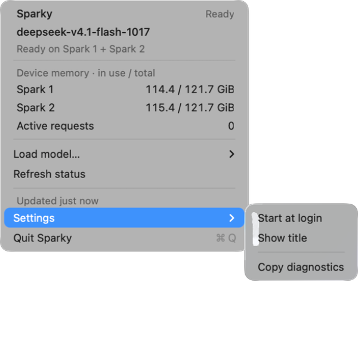

# Sparky

One native Go command controls the two Sparks and launches Claude Code, Hermes, Codex, or OpenCode. It runs on the Mac and on both Sparks as a single standalone binary.

```sh
sparky
sparky claude --model nemotron
sparky hermes --model glm
sparky codex --model deepseek --project ~/dev/project
sparky opencode --model qwen
```

Running `sparky` without arguments shows help. Normal commands use bordered tables, clear section headings, and separate detail cards. Running states are green. Stopped states are dim. Warnings are yellow and errors are red. State labels remain visible without color. Colors are automatic in a terminal and disabled in redirected output. Use `--color always` to force them, or `--color never` to disable them. `NO_COLOR` is respected in automatic mode. Very narrow terminals use cards. Every public data command accepts `--json` for scripts. You can put it before or after the command. Nested configuration commands also accept it at the end.

```sh
sparky status                       # What is running and how much RAM is available
sparky models                       # Names and configured context limits; no model load
sparky models qwen                  # Full model ID, aliases, limits, and configured devices
sparky models --installed           # Include audio, ComfyUI, and image checkpoints
sparky devices                      # RAM, disk, GPU allocation, and containers
sparky plan load glm                # Explain required swaps without changing services
sparky config show                  # Central configuration as a table
sparky config show qwen             # Per-placement model settings
sparky config validate              # A validation result, without a file dump
sparky logs --limit 5               # Local harness launch history
sparky doctor                       # Check every installed harness and the gateway
```

`sparky status` groups running workloads by Spark. Each row shows the context limit, measured GPU allocation, and host RAM. Host RAM uses proportional resident memory (PSS), which divides shared pages among their processes. GPU memory includes weights and allocated context caches. These are observations of shared physical RAM and can overlap. Do not add the two columns.

The status probe reads NVIDIA per-process allocations, process memory summaries, exact container identities, and systemd cgroups. It includes Parakeet, ComfyUI, other containers, and other host processes. Missing measurements show `unknown`. Context comes from the running backend when it publishes a limit. A `*` marks a configured fallback. The LLM calls column is omitted. Full byte counts and sources remain in `status --json`.

LLM container identities for measurement are declared in each model's `monitoring.containers` list in the central file. This metadata does not change placement, model limits, or startup recipes. Sampling uses the existing administrator SSH and sudo access. It does not create a monitor service or change the running engines.

A configured route is not proof that a model is loaded. Use `status` for actual running placement. `models --installed` describes installed image weights as **on demand**. Their memory residency is not inferred from files on disk.

Long model operations print progress to stderr. They finish active work before a device changes. A load prints the idle models it needs to unload. ComfyUI submission returns a job ID; it does not claim that execution has finished. Pressing Ctrl+C stops the local wait. Remote work may still continue. Check `sparky status` before another operation.

For launch previews, use `--dry-run`. Use `--prepare` to write harness settings without starting it. Both print a short human summary. Add `--json` only if a script needs the full launch plan. To pass a harness's own options, put them after `--`.

```sh
sparky claude --model qwen --dry-run
sparky codex --model nemotron --prepare
sparky codex --model qwen -- exec --json 'Explain this project'
```

JSON stdout contains exactly one result object. Progress and banners do not enter it. Script errors use JSON on stderr and a nonzero exit status. Exit 1 means an operation failed. Exit 2 means command syntax is invalid. Exit 130 means the local wait was interrupted. `doctor` and `devices` can return a partial result with exit 1. Native harnesses keep their own output and exit status. Sparky's `--json` applies to harness previews; a harness's native JSON flag goes after `--`.

```sh
sparky status --json
sparky --json plan load glm
sparky config show qwen --json
sparky logs --limit 5 --json
```

`ui --json` returns the UI URL without opening a browser. Logs can be read without gateway access or a client file. Bad history files are skipped and reported. `--offline` always labels cached model data. SSH operations give a sign-in link when Tailscale needs an identity check. They do not print private SSH diagnostics.

## Central configuration

The authoritative model file lives on Spark 1:

```
/home/spark-user/spark-cluster/config/models.json
```

It lists installed LLMs, Parakeet, Whisper, both ComfyUI engines, and installed ComfyUI checkpoints. Whisper stays disabled. Parakeet has `keep_loaded: true` and appears in `policy.protected_models`.

Language model idle unloading is disabled. Shared ComfyUI execution requires an explicit model allowlist and a tested memory minimum. See Resource control below.

Each LLM has a `run_on` value: `spark01`, `spark02`, or `both`. Its `settings` contain the supported placements. Each placement specifies its nodes, systemd units, model context, backend address, startup memory check, and numeric runtime parameters. A two-device placement runs one distributed model. It does not create two independent copies. The prepared Qwen two-device recipe needs a separate runtime load test before its performance can be claimed.

Use [cluster.example.json](cluster.example.json) as a generic site example. Its `spark-user` account, example domain, and documentation IP addresses are placeholders. Replace them with your site values before installation. Keep the real configuration outside the repository. Edit the file on Spark 1. Spark 1 derives service ownership from the model placements and sends each read-only probe over the direct link. Copied service lists do not control model detection. The small node files on Spark 2 support the ComfyUI service guard. They are not another model authority.

```sh
sparky config show
sparky config validate
sparky plan load qwen --on both
sparky config placement qwen both
sparky load qwen
```

A placement change applies on the next load. Use a plan first to see which idle models must leave memory. Resource plans never stop services.

Set `auto.routing` to `bifrost` to share new sessions across ready models in
`auto.targets`. Bifrost chooses with equal weights and remembers each session's
provider and model. Send the bare model name `spark-auto` and a stable
`x-bf-session-id`. The launchers use each coding harness's native conversation
ID. Hermes uses its conversation root for main and auxiliary requests.

Sparky updates its owned `sparky-spark-auto` rule after readiness and before a
planned model stop. It also checks availability at controller startup and on
the reconciliation loop. A stopped or failed model leaves the route pool.
Its sessions move to a remaining model on their next successful request.
An empty pool returns HTTP 503. A failed gateway update prevents a planned
unload and appears in the catalog's `routing_error` field.

The automatic catalog publishes a common token budget from all permitted
model recipes and the running deployments. This keeps the budget valid when
an already permitted smaller model loads. Changes to the permitted recipes
can still reduce that budget. Named model requests retain each model's limits.
Bifrost's session bindings expire after one idle hour by default and reset
when its binding store resets. Parallel first requests can use different
routes until the first response establishes the binding.

### Load a model on one node

Use `--on` to select a placement for one load. For example, Qwen Flash Next's
example configuration has recipes for either Spark:

```sh
sparky config show qwen3.8-flash-next
sparky plan load qwen3.8-flash-next --on spark01
sparky load qwen3.8-flash-next --on spark01
sparky status
```

Use `spark02` instead of `spark01` to select Spark 2. Use `both` for a configured
two-device recipe. The plan is read-only. `load` waits for active work to finish.
The override does not change the saved `run_on` value. A later load without
`--on` uses that saved value. Requests use the actual loaded placement.

To save a default for later loads, use:

```sh
sparky config placement qwen3.8-flash-next spark01
```

This configuration command does not move a running model. The next load without
`--on` applies the saved placement.

A model must have an enabled recipe for the requested placement in its `settings`.
The checked-in DeepSeek example has only a `both` recipe. A single-node override
for that model fails before Sparky cancels requests or stops models, including
with `--force`. Check your deployed configuration with
`sparky config show <model>` before selecting a placement.

Per-load placement requires the native lifecycle. Update the client CLI, private
node binary, and running controller together before using `load --on`. The node
checks controller support before it sends the load command. It rejects an older
controller that cannot apply the override.

## Resource control

The controller runs as `sparky-controller.service` on Spark 1. In legacy mode, the existing llama-swap manager handles explicit model loading and unloading (the native lifecycle has its own supervisor). Inference cannot start a stopped model. Idle unloading is disabled. Sparky derives its compatibility matrix from the central model placements. Nemotron on Spark 1 and Qwen on Spark 2 can run together. The two-device models require both nodes.

The controller tracks node reservations for LLM requests and ComfyUI jobs. Conflicting work waits. Active LLM requests and active image jobs finish before a conflicting model is unloaded. Unknown activity prevents unloading. Idle ComfyUI caches can be released. Protected Parakeet containers stay loaded. These are software admission checks. They do not create a hardware GPU memory cap.

A ComfyUI custom node reserves the device for the full execution of each job. This also covers jobs submitted through the existing ComfyUI UI. Existing services, workflows, assets, and image outputs stay in place. The controller uses no kernel, driver, or global memory changes.

```sh
sparky status
sparky devices
sparky models --installed
sparky plan load glm
sparky load glm
sparky unload glm
sparky unload qwen --force          # Cancel Qwen requests and stop Qwen
sparky load deepseek --force        # Cancel conflicting requests, stop their models, then load
sparky run comfyui workflow-api.json --on spark02
```

Language models use explicit load and unload commands. Inference requests never
load a stopped language model or replace a loaded one. If the selected model is
not ready, the gateway returns an error that asks the agent to ask the human to
switch the model. The error tells the agent not to load or unload models automatically.
`spark-auto` selects a ready target. It returns an error if no target is ready.
The controller sends admitted inference directly to the reserved model server
in both lifecycles. In legacy mode, llama-swap still handles explicit model
loading and unloading only. The controller
keeps request limits, device reservations, streaming, and forced cancellation.
Language model idle unloading is disabled. The legacy `idle_ttl_seconds` field
does not enable it. Exclusive image jobs wait until you explicitly unload any
language model that occupies their device.

`load --force` and `unload --force` support language models. They cancel conflicting manager requests and waiting device reservations. They stop the affected model services before the requested operation. Requests can fail and partial replies can end. Cancellation has a 30-second drain limit. Service shutdown and model startup can take longer. Protected models and active image jobs still block the operation. Without `--force`, active work finishes first.


`sparky run` starts ComfyUI if needed. A separate `sparky load` command is optional.
For image checkpoints, `load` prepares the service; the workflow loads the weights.

Shared image execution is opt-in. The default policy keeps GPU image jobs exclusive.
To share with an existing language model, set `comfyui_exclusive_with_llms` to `false`,
list approved model IDs in `comfyui_shared_llms`, and set a positive
`comfyui_min_available_gib`. The controller checks host `MemAvailable` on the image
node. If memory is low, it releases only idle ComfyUI caches, checks again, and waits
if necessary. It never unloads an LLM to admit a shared image job. LLM startup and
explicit unload still require exclusive reservations. These checks are not a hard
memory limit. Test each image workflow and size before enabling it for clients.

The optional image API uses the installed ComfyUI engine. Enable `image_api` only on
`flux2-klein-4b` with `{"enabled": true, "node": "spark02"}`. It exposes
`POST /v1/images/generations`, uses the FP8 checkpoint with four sampling steps,
and returns `data[0].b64_json`. It supports one image per request at 512, 768, or
1024 square pixels. It does not support image editing or streaming. Gateway image
requests run one at a time. Use a separate Bifrost image provider to preserve the
language provider's request slots. Existing ComfyUI UI and API workflows also use
the job guard. No ComfyUI browser session is needed.

`workflow-api.json` must be a ComfyUI API workflow. The installed checkpoints include image models. No dedicated video checkpoint was found during inventory.

## Harness configuration

`GET /sparky/catalog` exposes the central names, aliases, context limits, output budgets, modalities, and selected devices through the existing keyless inference ingress. The client fetches this catalog before each launch. It has no local model settings to override it. `spark-auto` keeps its existing gateway alias and uses the common context budget.

Speech services appear in the catalog's `audio_services` field and in `sparky models`.
Use `sparky config show kokoro` for the speech model, Bifrost API URL, default voice,
available voices, formats, and CPU placement. `sparky models --installed` and
`sparky status` include the running audio container. Speech services stay separate
from the language models offered to agent harnesses. The public speech metadata
does not include backend addresses or credentials.

The local file `~/.config/sparky/client.json` stores only gateway, SSH, client preferences, and executable paths. Local `models` settings are not supported; model settings belong on Spark 1. See [config.example.json](config.example.json). `SPARKY_CONFIG` selects another client file. `SPARKY_STATE_DIR` selects another local state directory. Use `--offline` explicitly to accept cached discovery data.

| Harness | Integration |
|---|---|
| Claude Code | Bifrost `/anthropic`, model mappings, context environment, request timeout |
| Hermes | Existing `providers.spark-gateway`, live catalog and contexts, native provider and model flags |
| Codex | Bifrost `/v1/responses`, generated model catalog, explicit context and compact threshold |
| OpenCode | Per-process `OPENCODE_CONFIG_CONTENT`, `/v1`, live model metadata |

The launcher preserves unrelated providers, credentials, MCP settings, permissions, and history. Hermes requires a narrow update to its existing Spark provider block. The launcher takes a private backup and preserves unrelated YAML values and comments. Other adapters use process settings or generated files. No adapter enables permission bypasses.

Some clients require a nonempty API token field. Their fixed placeholder is not a gateway secret. Inference remains keyless through Tailscale. Administrative SSH keeps its existing checks. Sparky is not an access boundary for a process that already runs as the administrator.

```sh
sparky claude --model qwen --dry-run
sparky codex --model nemotron --prepare
sparky sync
sparky doctor
sparky claude --model qwen -- --continue
sparky opencode --model glm -- run 'Explain this project'
```

Claude Code's context environment applies at launch. Start a new process to select a model with a different context window. Each harness retains its own summary policy. The Codex compact threshold defaults to 95 percent of context.

## Logs and access

Bifrost keeps the existing SQLite LLM call logs. Sparky records resource
decisions as JSON Lines on Spark 1 at `controller/events.jsonl` (one JSON
object per line, `0600`, appended under a file lock). Entries carry action,
time, workload, node, prompt id, and timing — never prompts, tokens, copied
environments, or credentials. Local launch records contain model, context,
project, timestamps, and exit status. Private configuration backups stay
outside the repository.

The controller binds loopback for gateway and administrator operations. Its direct-link listener accepts only scoped ComfyUI job operations from the configured node. Public ingress adds only the read-only catalog route. Administrator endpoints and credentials remain separate.

## Install and verify

The Go build is authoritative. It produces the `sparky` command and the
standalone `sparky-install` helper with no system package dependencies.

```sh
make build                # dist/sparky and dist/sparky-install (this machine)
make crossbuild           # darwin/arm64 and linux/arm64 under dist/
make test                 # Go test ./...
make race                 # Go test -race
sparky --help
```

`dist/` is build output and never committed. Builds use reproducible flags
(`-trimpath`, `-buildvcs=false`) and touch no network, services, or models.

Install the compiled `sparky` binary with the standalone installer:

```sh
./dist/sparky-install --source ./dist/sparky
```

The default target is `~/.local/bin/sparky`; pass `--target` to choose another
path. The installer validates that the source is a real binary for the current
machine's architecture, keeps a private backup of the previous target (its
bytes, or the original symlink name when the target is a `uv`-managed link),
and replaces the target atomically. If another writer changes the target
during the install, the install aborts and the target is left untouched. A
running process keeps using its old binary file; the replacement takes effect
on the next launch.

Replacing an old **Python zipapp** helper while the legacy Python controller
is still running would break its lazy imports. The installer refuses that
replacement by default. Drain and stop the old Python controller first, then
run again with `--legacy-processes-stopped`. The installer never kills
processes or changes services; it only confirms that you stopped them. This
explicit flag is for the one-time migration to the native binary.

Stage the cluster configuration on Spark 1. The explicit node installer
creates the controller service and ComfyUI guards. It waits for image queues
to drain before it restarts each ComfyUI service. It preserves running LLM
and Parakeet containers. It keeps private backups of changed server files.

```sh
sparky node install --dir /path/to/staged-config
```

The staged folder must contain `models.json`. The first install creates the central file. A later install preserves an existing central file. The `node` command is the private machine protocol. Normal users do not need it. Its output stays JSON for the manager and SSH transport.

`sparky` is the sole command. Old `spark`, `spark-models`, and `opencode-spark` commands are removed. There are no compatibility wrappers.

## Releases

Releases are cut from `main` by tag. Use a **stable numeric tag** — `vX.Y.Z`
only, for example `v0.6.3`. Prerelease and build-metadata spellings such as
`v0.6.3-rc.1` or `v0.6.3+build7` are rejected, so a published version always
means an approved `main` commit.

```sh
git tag v0.6.3
git push origin v0.6.3
```

`.github/workflows/ci.yml` runs on every pull request and every push to `main`:
`go vet`, `go test ./...`, the race detector, both crossbuilds, and a real
AppKit app build on a macOS ARM64 runner.

Both `ci.yml` and `release.yml` install Go with `go-version-file: .go-version`
(currently `1.27.3`), the pinned release toolchain, so CI tests exactly the
compiler that cuts a release. The `go 1.24.0` line in `go.mod` is only the
language minimum, not the supported release toolchain; `go.mod` and `go.sum`
stay unchanged.

`.github/workflows/release.yml` builds the tag and **fails closed**: nothing is
published unless every gate passes.

- The tag is `vX.Y.Z`, peels to a commit reachable from `origin/main`, and
  still points at that commit when publish runs.
- `go vet`, the tests, and the race run against the tagged commit, not the
  moving tip of `main`.
- Both platforms build from that exact commit and embed its full SHA, so
  `sparky --version` prints `sparky 0.6.3 (commit <sha>)`. A build from a plain
  checkout keeps the development default: it prints `sparky 0.6.2` with no
  commit injected (the version is only written in at release link time).
- Every archive is unpacked and checked before upload: the CLI must be a real
  ARM64 executable for its platform, `BUILDINFO.json` must record the tag,
  version, and commit, and the digests must match what was built.

Each release publishes the same asset set, and each tarball the same layout, so
install scripts never change between versions:

| Asset | Contents |
| --- | --- |
| `sparky-<version>-linux-arm64.tar.gz` | `sparky` and `sparky-install` for both Sparks |
| `sparky-<version>-darwin-arm64.tar.gz` | `sparky` and `sparky-install` for the Mac |
| `Sparky-<version>-darwin-arm64.app.zip` | `Sparky.app` menu bar app |
| `SHA256SUMS` | digest of every asset above |
| `release-metadata.json` | tag, commit, platforms, and per-file digests |

```
sparky-<version>-<os>-<arch>/bin/sparky
sparky-<version>-<os>-<arch>/bin/sparky-install
sparky-<version>-<os>-<arch>/BUILDINFO.json
sparky-<version>-<os>-<arch>/LICENSE
```

Install from a release: download the archive for your platform plus
`SHA256SUMS`, verify **only the archive you downloaded**, then extract and run
the bundled installer. `SHA256SUMS` lists all three assets, so checking the
whole file with a single archive would fail on the two you did not fetch; the
`awk` filter selects the one line for `${ASSET}` before `shasum`/`sha256sum`
verifies it.

On the Mac (Apple Silicon):

```sh
set -eu
VERSION=0.6.3
BASE=https://github.com/ajaykumarns/spark-launcher/releases/download/v${VERSION}
ASSET=sparky-${VERSION}-darwin-arm64.tar.gz
curl -fLO "${BASE}/${ASSET}"
curl -fLO "${BASE}/SHA256SUMS"
awk -v a="${ASSET}" '$2 == a' SHA256SUMS | shasum -a 256 -c -
tar -xzf "${ASSET}"
./sparky-${VERSION}-darwin-arm64/bin/sparky-install \
    --source ./sparky-${VERSION}-darwin-arm64/bin/sparky
sparky --version
```

On each Spark (Linux ARM64), use the `linux-arm64` archive and `sha256sum`:

```sh
set -eu
VERSION=0.6.3
BASE=https://github.com/ajaykumarns/spark-launcher/releases/download/v${VERSION}
ASSET=sparky-${VERSION}-linux-arm64.tar.gz
curl -fLO "${BASE}/${ASSET}"
curl -fLO "${BASE}/SHA256SUMS"
awk -v a="${ASSET}" '$2 == a' SHA256SUMS | sha256sum -c -
tar -xzf "${ASSET}"
./sparky-${VERSION}-linux-arm64/bin/sparky-install \
    --source ./sparky-${VERSION}-linux-arm64/bin/sparky
sparky --version
```

The installer keeps a private backup of the previous binary and replaces the
target atomically, so an interrupted install leaves the old binary serving (see
*Install and verify*). Unzip `Sparky-${VERSION}-darwin-arm64.app.zip` from the
same `${BASE}` URL and copy `Sparky.app` to `~/Applications`; the app is signed
ad-hoc by the build runner and is **not notarized**, so Gatekeeper warns on
first launch.

Build the same artifacts locally without publishing them:

```sh
make release-linux VERSION=0.6.3 COMMIT=$(git rev-parse HEAD)
make release-macos VERSION=0.6.3 COMMIT=$(git rev-parse HEAD)
```

They land in `dist/release/` with the per-platform `SHA256SUMS.<os>-<arch>`
files; only the workflow's publish step uploads anything.

Nothing in the release path deploys, installs, or restarts anything. The
workflow creates a GitHub Release with assets attached and nothing more —
downloading, installing, and restarting Spark stay explicit operator actions,
and publishing never overwrites an already published release.

## Updating an existing cluster

With Sparky 0.6.4 or newer on the Mac, one command updates the Mac CLI
and both Spark CLIs. Spark nodes can start from 0.6.3:

```sh
sparky update --check         # report what would change; writes nothing
sparky update                 # apply the newest release
sparky update --tag v0.6.4    # pin one release
sparky update --json          # machine-readable single object
```

`sparky update` is CLI-only. It replaces the `sparky` binary on each machine
and nothing else: no models, weights, recipes, configuration, services, or
menu bar app change. It reads the cluster hosts and `remote_root` from the
same central configuration every other command uses, so it needs no target
flags of its own.

How it works:

- The release is resolved from GitHub and every asset is verified against
  `SHA256SUMS` before anything is touched. A digest mismatch stops the run.
- Everything is staged locally in a private `0700` task directory first. Each
  Spark receives the verified Linux CLI, installer, and `BUILDINFO.json` under
  `<remote_root>/.sparky-update/<tag>-<task>/`, and every digest is confirmed
  by reading it back before any install runs.
- The head runs one transaction through the **staged** binary. Each Spark
  binary is replaced atomically with a private backup. The head controller
  restarts only when it is active and its running binary is stale. If a step
  fails, the transaction attempts to restore both Spark binaries.
- The Mac updates itself last, only after both Sparks report success, using
  the same verified installer path as a manual install. A failure anywhere
  before that leaves the Mac binary untouched.
- Task staging is removed after verified success or complete recovery.
  Uncertain outcomes keep the staging files for recovery. Backups are kept.

Safety gates: the run refuses while any load is queued, starting, or stopping,
and refuses when the head controller state cannot be read at all — an
unreadable state is treated as busy, never as idle. There is no force flag.
The Mac needs 0.6.4 or newer. Each Spark needs 0.6.3 or newer for the
file transfer protocol. Older installations need one manual update first.
Target releases must publish the per-binary hashes added in 0.6.4.

Exit codes: `0` success (a complete `--check` is also `0` even when an update
is available), `1` failure or an incomplete check, `2` usage error, `130`/`143`
interrupted. A partial per-component report is emitted even on failure or
interrupt, so you always see what converged. `sparky node self-update` is the
private protocol used by the updater; calling it directly returns an error
report and exit `1`.

## macOS menu bar

A native status icon opens a standard macOS menu: Sparky and the current state, the
real loaded model and placement, in-use / total memory per Spark, active
requests, a Load model submenu, Refresh status, and the last update time.
Settings holds start-at-login, show-title, and diagnostics. Quit is a main menu item.



Build and launch the menu app on macOS:

```sh
make menubar
ditto --norsrc --noextattr dist/Sparky.app ~/Applications/Sparky.app
open ~/Applications/Sparky.app
```

The bundle includes the CLI. Loading a model from the menu runs that CLI in the
background. Closing the menu does not cancel a load. Start at login is opt-in.
The native menu uses system spacing, keyboard navigation, checkmarks, and
submenus. It displays per-device memory; it does not combine the Sparks into
one memory budget.

See [docs/menubar.md](docs/menubar.md)
for flags, install, settings, and signing vs notarization. Go keeps all
business logic and runs the existing CLI in the background; a small AppKit
bridge only draws the view. It never loads a model on its own, and never unloads
or cancels remote work when you quit.

## Native lifecycle

The central file's `lifecycle` field selects the model lifecycle. The default
is **llama-swap**: with `lifecycle` unset or `"llama-swap"`, llama-swap keeps
handling explicit load and unload exactly as today, while admitted inference
is proxied by the Go controller straight to the model server (in both
lifecycles), and the native records and supervisor stay dormant
(`internal/sparky/runtime.go`, `internal/sparky/image.go`). Only `"native"` switches the native
path; any other spelling is rejected, never silently mapped.

With `lifecycle: "native"`:

- **Durable supervisor.** Each model start writes a lifecycle record under
  `controller/lifecycle/<name>.json` (single JSON file, `0600`, atomic) before
  any unit is started. The record freezes the recipe snapshot, nodes, units,
  placement, generation token, and recipe fingerprint. A systemd `ExecStop`/
  `ExecStopPost` hook calls `sparky node lifecycle --action stop|cleanup`, so
  a supervisor crash still drains the ranks it owns — ownership is read from
  the durable record, never from a live flag (`internal/sparky/native_supervisor.go`, `native_state.go`).
- **Exact-model readiness.** Readiness requires the backend's `/v1/models` id
  to match the catalog name exactly (not an alias or prefix) and all recorded
  ranks to stay in the exact systemd unit. A stale health endpoint on the
  recipe port refuses the start.
- **Stop and rollback.** Stop only touches the units this generation actually
  attempted (durable attempt flags) or, once ready, all recorded units.
  A failed startup rolls back the ranks it started and confirms them stopped
  before the record goes to `failed`. A failed recipe render rolls the
  original live file back from its captured mode and content.
- **Same-model migration.** A re-run of the same model with the same recipe
  fingerprint adopts the in-progress `queued`/`starting` record instead of
  restarting; a different fingerprint on an in-flight model is refused. The
  switch-over conditions remain the operator's: agent sessions drained and
  idle, gateway auth active, zero queued requests, and the old Python
  controller stopped — see the installer note below for the zipapp rule.
- **Protected guards.** Protected audio (Parakeet) containers and active or
  unknown image-engine work always block a start that needs their devices;
  failures and unknowns are never read as idle. The ComfyUI guard remains the
  engine-owned `internal/sparky/assets/comfy_guard.py`.

The controller serves the compatibility surface Bifrost and clients use:
`GET /v1/models` (exact ids plus aliases), loopback `POST /v1/chat/completions`
and `/v1/completions`, `GET /sparky/catalog`, `GET /v1/image-models`,
`POST /v1/images/generations`, `GET+POST /control/*`, and `POST /jobs/acquire|release|cancel`. The `/v1/responses`, `/v1/embeddings`, Anthropic, and audio routes stay with the nginx/Bifrost layer, and llama-swap's private UI endpoints are deliberately not exposed.

## Legacy Python source

The `src/` and `tests/` Python trees are reference and rollback only. They are
not built or installed; run them only for comparison with
`make test-python-reference`. The migration to the native Go binary drains
and stops the old Python controller before the helper is replaced, keeps the
same selected model placement, retains private backups for rollback, and
brings manager parity up to date before the native path is switched on.
Native deployment is verified and current (see [docs/VALIDATION.md](docs/VALIDATION.md)).
The legacy default is retained for controlled migration and rollback: with
`lifecycle` unset or `"llama-swap"`, llama-swap keeps handling explicit load
and unload as before; admitted inference goes to the model server directly in
both lifecycles. The native lifecycle is an explicit configuration choice
(`"native"`) with its own durable record, supervisor, and rollback path. The
Python-engine-owned ComfyUI guard and the OCR bootstrap are unchanged
exceptions owned by the engines. The Python Sparky trees in `src/` and
`tests/` are reference and rollback only; they are unused by the installed
native binaries.

The interface review is in [docs/usability-review.md](docs/usability-review.md). The full correctness review is in [docs/correctness-review.md](docs/correctness-review.md). Current checks are in [docs/VALIDATION.md](docs/VALIDATION.md).

Focused verification tools cover resource planning, node reservations, guarded ComfyUI execution, numeric recipe rendering, native harness parsers, and synthetic harness requests. Synthetic tests do not prove model quality. Live checks must distinguish a prepared recipe from a loaded and verified model.


## OCR service

OCR management uses administrator SSH to Spark01. Update Sparky on the client and
Spark01 before using these commands. It does not require an update on Spark02.
The client file must have `admin_ssh_host`, an absolute `remote_root`, and the
HTTPS Bifrost `gateway`. The cluster root must already contain the Bifrost setup.

Spark01 needs Git access to the private OCR repository, Docker Engine, the Compose
plugin with GPU support, NVIDIA Container Toolkit, and passwordless `sudo -n docker`
for the administrator account. Git authentication stays on Spark01. Do not put
credentials in the repository URL. OCR bootstrap downloads pinned model weights.

```sh
sparky ocr install --repo git@github.com:OWNER/PRIVATE-OCR.git --ref main
sparky ocr status
sparky ocr stop
sparky ocr start
sparky ocr status --json
```

The first install requires `--repo`. Use a commit hash with `--ref` for a fixed
source revision. Later `sparky ocr install` reuses the saved repository and ref.
It checks out that ref again. For a branch, this installs its current commit.
For a commit hash, it keeps that exact commit. Use `--rebuild` to rebuild images;
otherwise an existing image for the package version is reused.

Install builds missing images, prepares models, creates private service settings,
starts OCR, and registers its Bifrost provider and MCP tool. It preserves existing
OCR credentials and custom model-cache paths. It refuses to replace a Mistral
provider owned by another service. A failed activation attempts to restore the
previous OCR service. Build and registration details stay in a private install log
on Spark01. JSON stdout contains one result. Interrupted remote work may continue;
check `sparky ocr status` before retrying.

Files are stored under `<remote_root>/ocr/`: `service.env` holds the private token,
`sparky-install.json` identifies the selected source revision, and `releases/`
contains source checkouts and install logs. Existing `ocr/source/deploy/.env`
settings are adopted on the first managed install. Previous source releases remain
on disk for recovery. They are not removed automatically.

Status reads container state and the HTTP health endpoint. It does not run OCR,
load models, or change services. `api_ready` checks the API, not OCR accuracy or a
warm GPU worker. Start uses the installed image and settings. It does not build
or download weights. Stop stops only the `spark-ocr` container and releases its
worker memory. Model files and Bifrost registrations stay in place. Requests while
OCR is stopped fail; they do not start it. Run `sparky ocr start` explicitly.

These commands do not load, unload, or restart language models. OCR is a separate
Docker service. Resource admission for language and image models does not account
for OCR allocations. A GPU allocation failure produces an OCR error. This interface
does not add a new scheduling or model-switch policy.
